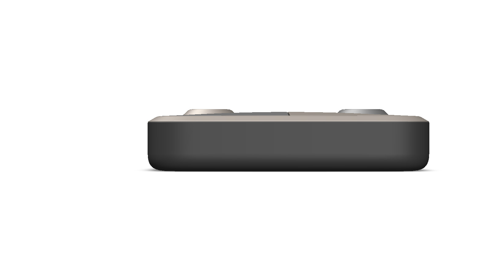
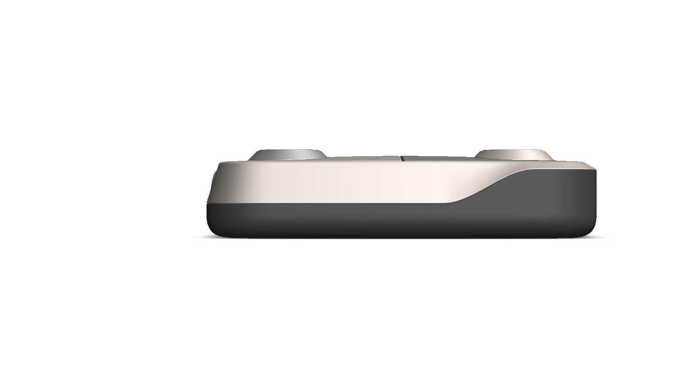
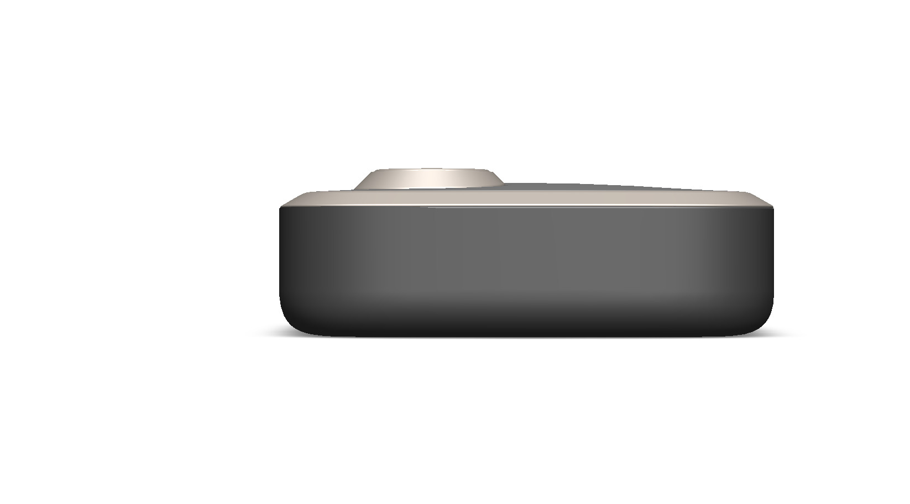
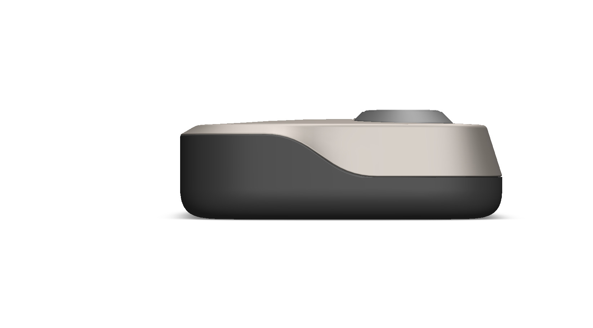
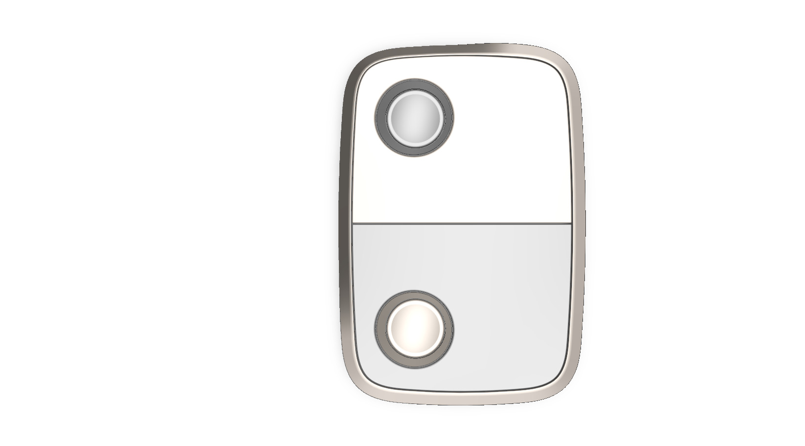
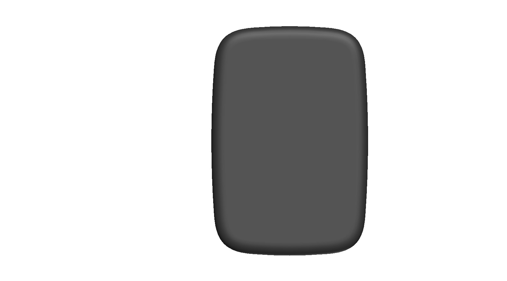
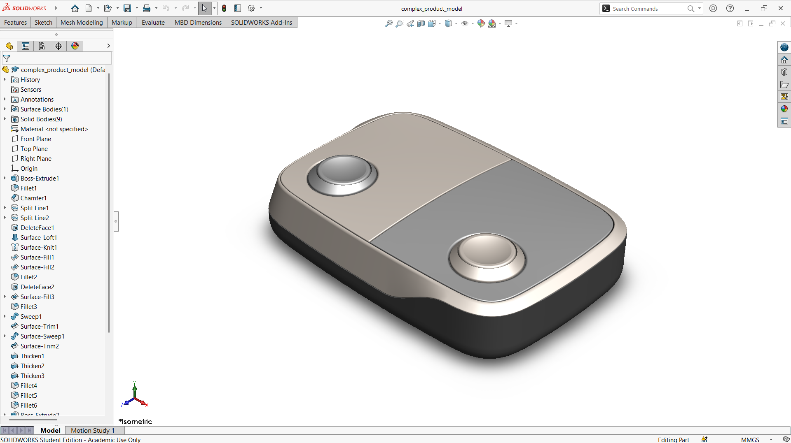
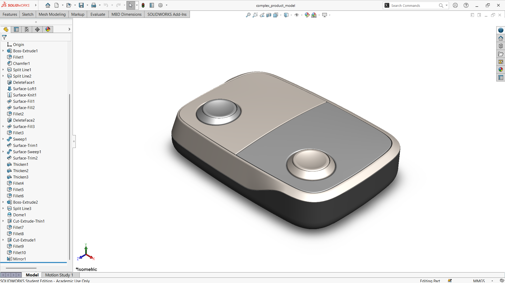

# A Two-Tone Rounded Box with Two Push Switches

## Summary

Small handheld boxes with one or two push switches are everywhere, from key-fob remotes that open a gate or a garage door to switch boxes that let people with limited mobility operate toys and computers. A good design for such a device has to feel comfortable in the hand, keep the switches easy to find and press, and look clean and finished.

This concept design prototype was inspired by a YouTube video. The model is a flat, rounded rectangular box with a dark lower shell and a lighter top cover. The cover is split into two panels of different tones, and each panel carries one round push switch set inside a raised rim, placed at opposite ends of the box. The top cover curves smoothly down over the edges and meets the dark shell along a flowing line. The feature tree shows that the body was built mainly from surfaces, which were lofted, filled, trimmed, and knitted together before being thickened into solid bodies. Keeping these curved surfaces smooth and continuous around the rounded corners was the main modeling challenge.

The box was developed as a computational model in SolidWorks. The views and the section view below show how the two-tone cover, the two switches, and the hollow shell come together. This prototype is a base concept design that can be developed further into a working two-button remote or switch interface.

---

## Computational Design

|   View    | Image |
| :-------: | :---: |
| Isometric |  |
| Left |  |
| Right |  |
| Back |  |
| Front |  |
| Top |  |
| Bottom |  |
| Section |  |

---

## Software Used

| Purpose |               Name                |
| :-----: | :-------------------------------: |
| Design  | SolidWorks 2024 (Student Version) |

---

## Tools Used

| No  |        Name        |
| :-: | :----------------: |
| 01  |    Boss Extrude    |
| 02  |       Fillet       |
| 03  |      Chamfer       |
| 04  |     Split Line     |
| 05  |     Split Line     |
| 06  |    Delete Face     |
| 07  |    Surface Loft    |
| 08  |    Surface Knit    |
| 09  |    Surface Fill    |
| 10  |    Surface Fill    |
| 11  |       Fillet       |
| 12  |    Delete Face     |
| 13  |    Surface Fill    |
| 14  |       Fillet       |
| 15  |       Sweep        |
| 16  |    Surface Trim    |
| 17  |   Surface Sweep    |
| 18  |    Surface Trim    |
| 19  |      Thicken       |
| 20  |      Thicken       |
| 21  |      Thicken       |
| 22  |       Fillet       |
| 23  |       Fillet       |
| 24  |       Fillet       |
| 25  |    Boss Extrude    |
| 26  |     Split Line     |
| 27  |        Dome        |
| 28  |  Thin Cut Extrude  |
| 29  |       Fillet       |
| 30  |       Fillet       |
| 31  |    Cut Extrude     |
| 32  |       Fillet       |
| 33  |       Fillet       |
| 34  |       Mirror       |

---

## Feature Tree

| No  | Image |
| :-: | :---: |
| 01  |  |
| 02  |  |

---

## Applications [^1][^2]

- Garage Door and Gate Remote
- Two-Device Wireless Key Fob (for example, a gate and a roller shutter)
- Wheelchair-Accessible Ramp Remote
- Assistive Switch Box for Switch-Adapted Toys
- Two-Switch Computer Access for Learning Software
- Wireless Switch Interface for Tablets and Phones

---

## Design Limitations

The design of the box having two switches was developed as a prototype product. That’s why the real-life design considerations, including internal electronics and battery space, switch selection and actuation force, enclosure assembly and sealing, material selection, usability, proper design specification, monetization, and feasibility, have not been included.

---

## Future Improvements

The box is currently only an external shell with two switches. After adding electronics, such as a microcontroller, a wireless transmitter or Bluetooth module, and a battery, the box can be used as a working device, for example a two-button remote or switch interface. For this, the section view should be used to design the internal layout, including a PCB mount, battery compartment, switch mounting posts, and a fastening method for the two halves of the enclosure. The button travel, tactile feedback, and cable or charging port cutouts should also be checked on a printed prototype. Functional testing, including range, battery life, and durability under repeated presses, should be considered before it becomes a real product.

---

## Acknowledgements

Special thanks to the [EasyCAD Solutions](https://www.youtube.com/@EasyCADSolutions) YouTube channel for the SolidWorks tutorials that helped in creating this design.

---

## References

[^1]: [Chamberlain 2-Button Keychain Garage Door Remote](https://www.farmandfleet.com/products/1615082-chamberlain-2-button-keychain-garage-door-remote.html)

[^2]: [Switches 101: Switches as Assistive Technology](https://cdci.w3.uvm.edu/blog/pedsprovt/switches-101-switches-as-assistive-technology/)
