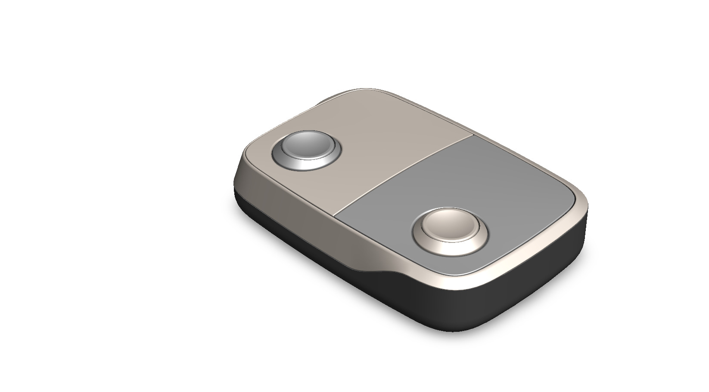
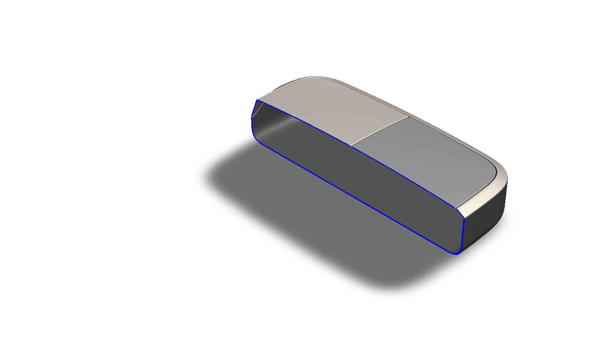

# Concept Design Prototype of A Box Having Two Switches

## Summary

Designing this concept design prototype was inspired by a YouTube video.

---

## Computational Design

|   View    |                               Image                                |
| :-------: | :----------------------------------------------------------------: |
| Isometric |  |
|   Left    |            |
|   Right   |          |
|   Back    |            |
|   Front   |          |
|    Top    |              |
|  Bottom   |        |
|  Section  |      |

---

## Technologies Used

### Software

| Purpose |               Name                |
| :-----: | :-------------------------------: |
| Design  | SolidWorks 2024 (Student Version) |

---

## Applications [^1][^2]

- Garage Door and Gate Remote
- Two-Device Wireless Key Fob (for example, a gate and a roller shutter)
- Wheelchair-Accessible Ramp Remote
- Assistive Switch Box for Switch-Adapted Toys
- Two-Switch Computer Access for Learning Software
- Wireless Switch Interface for Tablets and Phones

---

## Design Limitations

The design of the box having two switches was developed as a prototype product. That’s why the real-life design considerations, including internal electronics and battery space, switch selection and actuation force, enclosure assembly and sealing, material selection, usability, proper design specification, monetization, and feasibility, have not been included.

---

## Future Improvements

The box is currently only an external shell with two switches. After adding electronics, such as a microcontroller, a wireless transmitter or Bluetooth module, and a battery, the box can be used as a working device, for example a two-button remote or switch interface. For this, the section view should be used to design the internal layout, including a PCB mount, battery compartment, switch mounting posts, and a fastening method for the two halves of the enclosure. The button travel, tactile feedback, and cable or charging port cutouts should also be checked on a printed prototype. Functional testing, including range, battery life, and durability under repeated presses, should be considered before it becomes a real product.

---

## References

[^1]: [Chamberlain 2-Button Keychain Garage Door Remote](https://www.farmandfleet.com/products/1615082-chamberlain-2-button-keychain-garage-door-remote.html)

[^2]: [Switches 101: Switches as Assistive Technology](https://cdci.w3.uvm.edu/blog/pedsprovt/switches-101-switches-as-assistive-technology/)

---

## Acknowledgements

Special thanks to the [EasyCAD Solutions](https://www.youtube.com/@EasyCADSolutions) YouTube channel for the SolidWorks tutorials that helped in creating this design.
